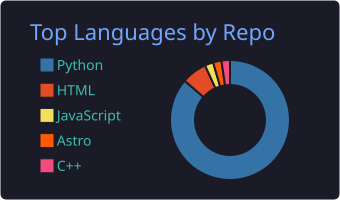
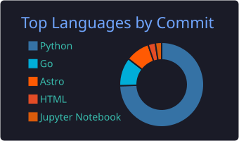

<h1 align="center">Hi there 👋, I'm Yash</h1>
<h3 align="center">Backend Engineer | Workflow Orchestration | Distributed Systems | Python & Go</h3>

I build the parts of a system that have to be <b>right</b>, not just fast — workflow engines,
async data layers, streaming pipelines, and the compilers and schedulers underneath them.

  
  
  

---

## 🌍 Open Source

<table>
  <tr>
    <td></td>
    <td>
      <b><a href="https://github.com/zigflow/zigflow">zigflow/zigflow</a></b>: declarative YAML workflows on Temporal, with no SDK boilerplate.  
      Zigflow compiles a workflow written in YAML (the CNCF Open Workflow Specification) into a full Temporal workflow, with retries, state management and deterministic execution. Teams get Temporal's durability without writing Go, Java or TypeScript workflow code.  
      🛠️ <b>Maintainer</b> since October 2026: reviewing PRs, keeping CI and dependencies healthy, and driving the road to v1.  
      
    </td>
  </tr>
</table>

**Highlights**
- **[#615](https://github.com/zigflow/zigflow/pull/615): activity inputs resolved in the workflow.** Every step now receives, and history records, the exact values the workflow computed, so a run can be debugged from its history alone.
- **[#623](https://github.com/zigflow/zigflow/pull/623): unblocked the project's CI.** A CVE in `golang.org/x/net` had failed the image scan on `main` and on every open PR for two days. The fix brought builds and image publishing back to green.
- **[#591](https://github.com/zigflow/zigflow/pull/591): cancelling a workflow now stops it.** A fork waits for its branches to be cancelled instead of returning while they keep running.

<!-- oss-contributions-ledger:start -->
**12 merged pull requests** across **2 repositories**, and **3 issues** reported. Took part in **9 discussions**. Reviewed **2 pull requests**.

Latest merged:

- [zigflow/zigflow#637](https://github.com/zigflow/zigflow/pull/637): fix(do): register every task list that runs as its own workflow (2026-10-23)
- [zigflow/zigflow#638](https://github.com/zigflow/zigflow/pull/638): fix(tasks)!: set the error instance to a JSON Pointer to the task (2026-10-23)
- [zigflow/zigflow#626](https://github.com/zigflow/zigflow/pull/626): refactor!: remove the GetVersion gates for activity inputs and activity names (2026-10-12)
<!-- oss-contributions-ledger:end -->

Full record: [CONTRIBUTIONS.md](CONTRIBUTIONS.md)

---

## 🧠 What I Work On

- ⚙️ **Workflow orchestration & durable execution** — Temporal, compensation, state you can reason about a week later
- 🧩 **Compilers & DSLs** — graph traversal, lowering, validation, normalisation; the interesting bits are all edge cases
- ⚡ **Async Python at the data layer** — SQLAlchemy 2.0, connection lifecycle, migration discipline
- 🕐 **Scheduling correctness** — recurrence rules, occurrence generation, timezone-aware scheduling
- 🔐 **Auth & access control** — asymmetric JWT, centralised verification, RBAC that holds at the fifth service
- 🎥 **Real-time media** — RTSP, HLS, WebRTC, and the bandwidth arithmetic behind choosing between them
- 🔍 **Observability of distributed work** — tracing an execution back to the intent that produced it

---

## 💻 Tech Stack

**Languages & Frameworks**

**Orchestration & Data**

**Infrastructure**

**Media & Protocols**

---

## 🎯 Currently

- 🔭 Deep in **workflow orchestration** — compilers, durable execution, making failures legible
- 🐹 Learning **Go** properly, mostly by fixing things in a runtime written in it
- 🌍 **Contributing upstream** instead of carrying patches locally
- ✍️ Getting better at the non-code half — design ownership, root-cause analysis, and writing things down

---

## 📊 Language Breakdown

  
  

---

## 👯 Open to Collaborate On

🐍 Python backend & distributed systems · ⚙️ Workflow orchestration & Temporal · 🧩 Compilers, DSLs and developer tooling · 🌍 Open source

---

**Backend Engineering · Workflow Orchestration · Distributed Systems**

